# Main findings (checked against the stored results)

My short list of what this AI-scientist run actually found, about which algorithm a code LLM writes and what can change it. Each note below was traced to its experiment folder and the headline numbers were confirmed in the stored result files (no experiments were re-run). Where a later round corrected or softened something, that's noted.

Source run: [`fork/run_jSassd-YWLVC`](https://github.com/ai-inventor-papers/ai-invention-295f8e-prompt-bans-substitute-not-just-subtract/tree/fork/run_jSassd-YWLVC) upstream (now merged into `main` here). Paper: [`paper.pdf`](paper.pdf), long report: [`report.pdf`](report.pdf).

**Read this first:**

- Almost everything is **Qwen3-8B, thinking off**, mostly on the two path tasks (T1 grid path, T2 weighted shortest path). Other models are named where they matter.
- Lots of experiments failed their own labeller gate and call themselves "descriptive". Treat numbers as solid counts, not as passed pre-registered tests.
- Across the whole run: **no confirmed novel algorithm**. Every knob only reshuffles known ones. (One disputed bin-packing candidate in round 10, see M3 below.)

## Scoreboard

| # | Note | Where | Verdict |
|---|---|---|---|
| 1 | Mentioning an algorithm forces it | [R1E1](round-1/experiment-1) | too strong: 100% for 2 of 9 |
| 2 | Post-training collapses diversity | [R1E5](round-1/experiment-5) | direction holds, confirmed on 1 of 2 tasks |
| 3 | Steering switches mode, but so does a random direction | [R1E4](round-1/experiment-4) | holds |
| 4 | Temperature and seeds do nothing | [R1E6](round-1/experiment-6) | holds on collapsed tasks; semantic seed is the exception |
| 5 | Single ban works, multi-ban doesn't | [R2E9](round-2/experiment-9) | holds |
| 6 | Plan noise gets diversity on T03, T10 | [R4E19](round-4/experiment-19) | holds per task; not the best knob overall |
| 7 | One token decides the algorithm | [R6E31](round-6/experiment-31) | holds, but it's in the code, not the CoT |
| 8 | Temperature at the fork is a precise dial | [R8E39](round-8/experiment-39) | weakened: predictable, not powerful |
| 9 | Circuit components steer more precisely than R1E4 | [R8E41](round-8/experiment-41) | weakened: random components do nearly as much |
| 10 | Only Qwen3-32B obeys the multi-ban | [R8E44](round-8/experiment-44) | holds (thinking on); the "most dissimilar" remark doesn't |
| 11 | Under multi-ban the model just renames | [R9E45](round-9/experiment-45) | true for most models, not for the one that obeys |

## The findings

### 1. Mentioning an algorithm pulls the model to it (not always 100%)

> original note: *just mentioning an algorithm, forces implementation 100%* [round-1/experiment-1]

Prompt: "X is one well-known approach to this task; implement any correct algorithm", 50 samples each. Baseline for all of these is 0%.

| Mentioned | Share writing it |
|---|---|
| DFS | 50/50 |
| Bellman-Ford/SPFA | 50/50 |
| Floyd-Warshall | 86% |
| IDDFS | 72% |
| A* | 56% |
| bidirectional BFS | 10% |
| Dijkstra-on-grid, Dial, bidirectional Dijkstra | 0% |

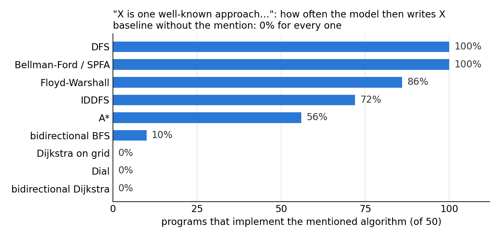

*Drawn for this doc from `mention_effects.json`.*

- So "100%" is true for 2 of 9. Still a huge effect: a mere mention acts as a recommendation.
- Shares count all programs, not correct ones: mention-DFS is 50/50 DFS but only 15/50 pass.
- Evidence: `round-1/experiment-1/src/results/mention_effects.json`.

### 2. Post-training (instruct tuning) concentrates the choice

> original note: *post-training (instruct tuning) collapses diversity* [round-1/experiment-5]

Same chat-template tokens, instruct vs Qwen3-8B-Base, correct programs only:

| Task | Instruct | Base |
|---|---|---|
| T1 | BFS 200/200 | BFS 49/57, DFS 7, A* 1 |
| T2 | Dijkstra 193/200 | Dijkstra 63/90, Bellman-Ford 24 |

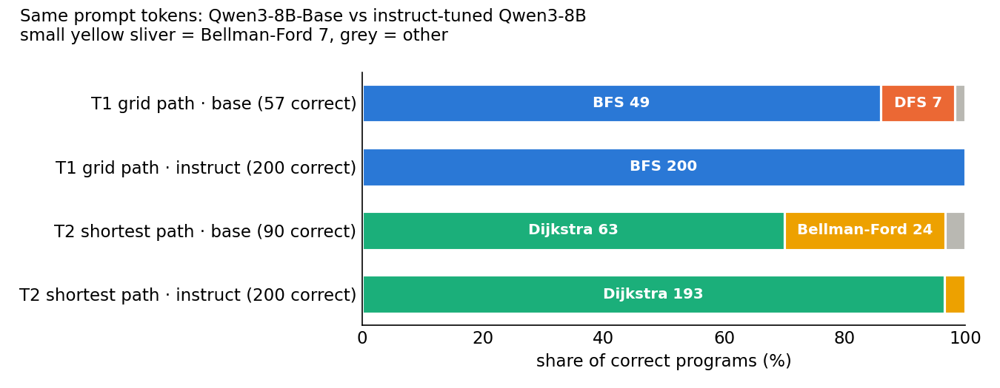

*Drawn for this doc from `audit_rederive.json`.*

- The experiment's own verdict is "installed by post-training" on **T2 only**; T1 misses its bar (14.0 vs 15 points).
- The base model already preferred the same algorithm (BFS 86%, Dijkstra 70%); tuning sharpened it, it didn't create it.
- Base numbers rest on few correct programs (57 and 90 out of 300).
- The paper later reframes this as a margin at the deciding token (instruct exceeds base by 2 to 13 nats on three tasks, from R8E43; not re-checked here).
- Evidence: `round-1/experiment-5/src/results/analysis.json`, `audit_rederive.json`.

### 3. Steering switches the algorithm, but a random direction can too

> original note: *steering can get you predictive mode switch, but a random dir can have same effect* [round-1/experiment-4]

T2, layer 18, 100 samples per arm:

| Arm | Correct programs |
|---|---|
| no steering | Dijkstra 88, Bellman-Ford 7 |
| "list vs implement" direction | Bellman-Ford 54, Dijkstra 23 |
| random direction 1 | Dijkstra 53, Bellman-Ford 26 |
| random direction 2 | Dijkstra 82, Bellman-Ford 5 |

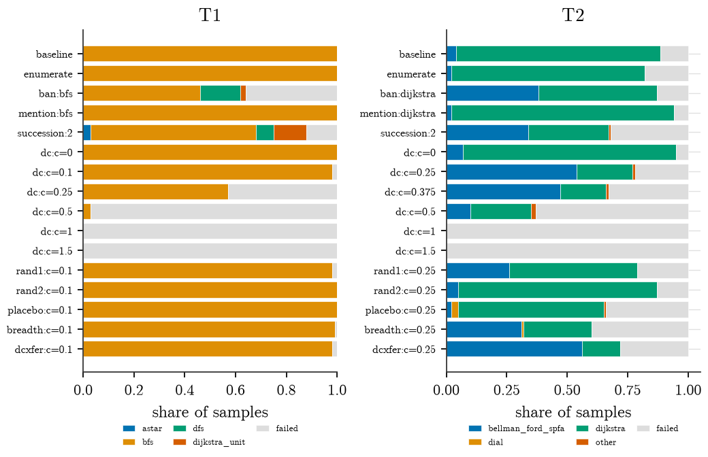

*Run figure. Right panel (T2): compare `dc:c=0.25` (the learned direction) with `rand1:c=0.25` and `rand2:c=0.25`. Left panel (T1): BFS everywhere until the model just breaks (grey = failed).*

- Diversity gain is about the same for the learned direction and random direction 1 (difference +0.07, interval −0.26 to 0.39). The second random direction does nothing.
- T1 never moved: BFS 100% in every steering arm.
- The switch costs about 17 pass-rate points. A plain ban prompt was cheaper.
- Later rounds turn "random directions work" into a headline: random perturbations change the algorithm in 55% of seeds where temperature changes none.
- Evidence: `round-1/experiment-4/src/results/buy_table.csv`, `screen_verdict.json`.

### 4. Temperature and random seeds only rephrase

> original note: *temperature and seeding doesn't do shit (just rephrase)* [round-1/experiment-6]

- Across T = 0.3 to 1.3 with top-k and top-p: **797/800 BFS** on T1 and **797/800 Dijkstra** on T2. With thinking on: 800/800 both.
- Meanwhile phrasings multiply: on T1, 3–4 phrasing clusters at T=0.3 become 24–36 at T=1.3, while ideas stay at 1–2.
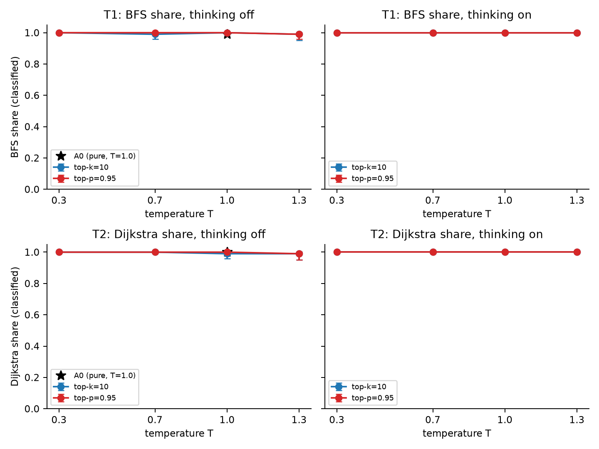

*Run figure. Flat lines at 100%: temperature does not touch the algorithm.*

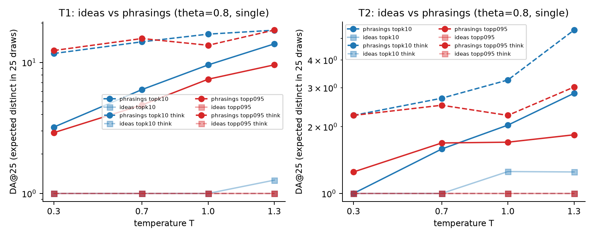

*Run figure. Phrasings (circles) climb with temperature; ideas (squares) stay at 1.*

- Random seed strings and word lists: shift of +1.0 and 0.0 points.
- **Exception:** a *semantic* seed (a little story implying the approach) moved T2 by 66 points toward Bellman-Ford. That effect was unstable in later rounds.
- **Scope:** this is for collapsed tasks. On tasks where the model already writes two algorithms, temperature does shift the mix (it never adds a third).
- Evidence: `round-1/experiment-6/src/results/verify_headlines.json`, `summaries.json`.

### 5. Ban one algorithm and you get a substitute; ban five and you get the banned ones back

> original note: *ban 1 algorithm works - implements replacement, but ban multi does nothing* [round-2/experiment-9]

| Ban | Result (of 100) |
|---|---|
| BFS on T1 | DFS 86, BFS 14 |
| Dijkstra on T2 | Bellman-Ford 83, Dijkstra 16 |
| five names on T1 | BFS 63, DFS 36, IDDFS 1 → 0 comply |

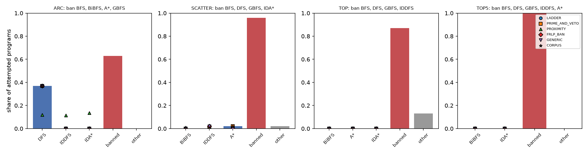

*Run figure. Red = programs that still implement a banned algorithm. The more of the repertoire is banned, the more the model just writes a banned one anyway.*

- Not literally "nothing": BFS drops from 100% to 59–69%, with about a third DFS, whatever is on the list. It acts like a generic nudge.
- In 41–92% of those programs the model re-implements the banned algorithm without naming it. This is the seed of finding 11.
- Wording matters a lot: the single BFS ban gets only 0.30 on one template, and one template fails on 10 of 12 other tasks.
- Scope: this is a path-task result. On other tasks two-name bans are obeyed (T03 1.00, T06 0.96, T10 1.00) and whole tasks ignore even a single ban (only 5 of 12 bench tasks obey one, under any wording). See M5.
- Evidence: `round-2/experiment-9/src/results/landing.json`.

### 6. Plan noise buys diversity on k-th smallest and connected components

> original note: *plan noise PN (mid L random dir steer on prefill) gets diversity on T03, T10* [round-4/experiment-19] — *(iterated veto wins T06, novelty instruct wins T04, semantic seed wins T2)*

Plan noise = a fresh random direction per sample, added at the task-description positions of layers 12–23, during prefill only. Score is the effective number of correct algorithms reachable at small pass-rate cost.

| Task | Plan noise | Best other knob |
|---|---|---|
| T03 k-th smallest | **2.72** | novelty instruction 1.96 |
| T10 connected components | **2.09** | iterated veto 1.96 |
| T06 find duplicate | 1.00 | **iterated veto 2.73** |
| T2 weighted shortest path | 1.35 | **semantic seed 1.93** |
| T04 substring search | 1.00 | **novelty instruction 2.57** |

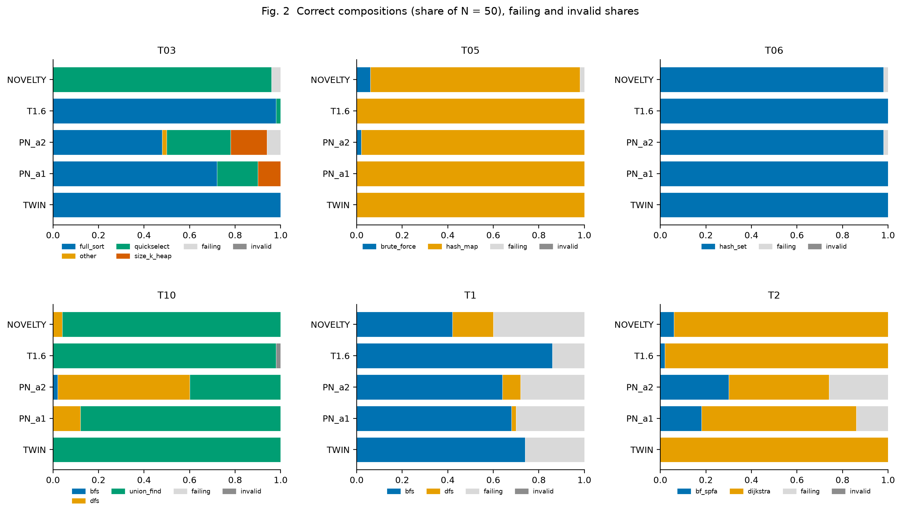

*Run figure. Each row is a knob (TWIN = untouched, PN = plan noise at two strengths, T1.6 = high temperature, NOVELTY = "be novel" instruction). Look at T03 and T10: plan noise is the row that splits into several colours.*

- All five "who wins where" claims in my note are exact.
- But the experiment's overall claim ("plan noise is the cheapest route") came out **PARTIAL**: it leads on 2 of 6 tasks.
- Round 7 showed the T10 effect depends on how the noise dose is scaled (about 50% off-default with one unit, 2–10% with another).
- Paper's own limitation: the perturbation moves the algorithm on only 5 of 15 tasks.
- Evidence: `round-4/experiment-19/src/results/c1.json`, `nonmovable.json`.

### 7. One token decides the algorithm

> original note: *in the CoT, one token decides on what algorithm is about to be implemented (token 32 "visited"->DFS)* [round-6/experiment-31]

- Model: **gemma-3-4b-it, thinking off**, grid path task. There's no chain of thought here; the fork is in the code itself. (That's the one thing my note got wrong.)
- 177 of 200 programs share the same first 32 tokens (`def solve(...)`, `rows = ...`, `cols = ...`). Token 32 decides:
  - ` visited` → DFS: only 15 of 1,409 continuations are BFS.
  - newline, `if`, `queue` → BFS: 95–100%.
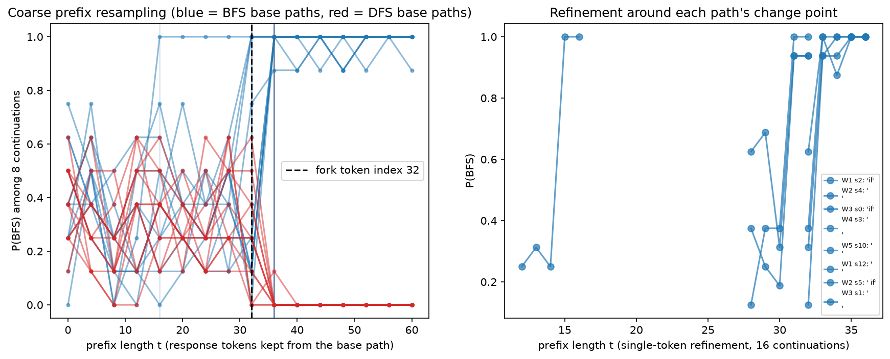

*Run figure, left panel. Keep the first t tokens of a program, resample the rest: until token 32 it is a coin flip, after it the algorithm is locked.*

- The first token that visibly identifies the algorithm comes a median of 138 tokens later.
- Later rounds found such forks on three Qwen3-8B two-algorithm tasks and two more Gemma tasks; sometimes it's two tokens. Llama's grid task doesn't have a clean one.
- Steering at the fork: the simple difference-of-means edit broke correctness (0/50 correct). A fitted rank-4 edit worked (38/50 correct BFS vs 13/50 untouched, R8E42), but a plain prompt rewording still beat it (49/50).
- The Qwen counterpart is M2 below: force the default's first body token and a ban is cancelled.
- Evidence: `round-6/experiment-31/src/results/fork.json`.

### 8. Temperature at the fork: predictable, not powerful

> original note: *temp. at deciding token (fork) is precise dial over existing algos (no new ones)* [round-8/experiment-39]

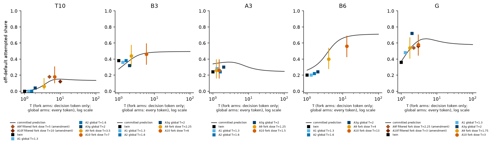

*Run figure (busy). Black curve = prediction made in advance, orange dots = what happened when only the fork token was heated. They agree; but on T10 (left) the curve itself never gets above ~15%.*

- **Predictable:** the algorithm mix after raising temperature only at the fork was forecast within 0.01–0.05 on 5 of 5 units.
- **Works where the model is already split:** valid anagram goes from 1.78 to 2.78 effective algorithms at 2 pass points.
- **Fails on a collapsed task:** on T10 it reached DFS in only 3–9 of 50 programs. The experiment's main claim is marked "not supported as committed".
- **No new ones:** 0 novel among 5,543 correct programs; forcing each of the top 64 fork tokens adds one known algorithm on 3 units.
- Evidence: `round-8/experiment-39/src/results/k1_verdict.json`.

### 9. Circuit components at the fork steer the algorithm, but so do random ones

> original note: *top components in circuit (AtP) gives more precise steering then R1E4* [round-8/experiment-41]

Steering the top 5 components at the deciding token, 30 samples, correct programs of the target algorithm:

| Task | Unedited | Top 5 circuit | 5 matched random |
|---|---|---|---|
| MST (→ Prim) | 8 | 29 | 23 |
| Connected components (→ DFS) | 1 | 29 | 30 |

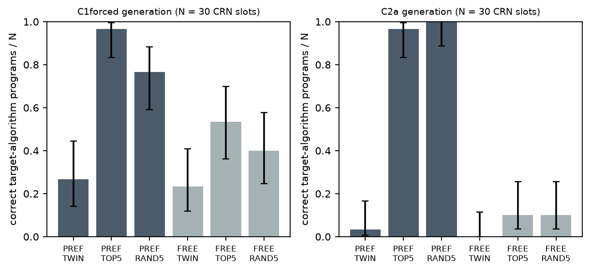

*Run figure. Dark bars: TWIN = unedited, TOP5 = circuit components, RAND5 = random components. TOP5 and RAND5 are nearly the same height.*

- Cleaner than R1E4 in one sense: nearly all programs still pass. Not more *specific*: random late components do almost as much.
- The circuit clearly beats random only at a lower dose, and only on connected components (30/30 vs 6/30).
- At the level of the fork logit the components are specific (9/10 and 8/10 beat 50 random ones).
- The ranking came from exact patching, not AtP: AtP missed the biggest node.
- No file compares this with R1E4 on a common metric, so "more precise than R1E4" is my reading, not a result.
- Final report's summary: specificity fails at these sites under steering, patching and weight edits alike.
- Evidence: `round-8/experiment-41/src/results/summary.json`; corrections in `round-10/evaluation-9/src/corrections.json` (items 0f, 0g).

### 10. Only Qwen3-32B with thinking gets past the five-name ban

> original note: *only Qwen3-32B obeys multi algo ban (cont. from R2E9)* [round-8/experiment-44] — *(it implements most dissimilar algoritm uw-Dijkstra, not a near non-banned cousing like biBFS)*

Correct programs that avoid all five banned names, of 50:

| Config | Survivors |
|---|---|
| Qwen3-32B, thinking on | 17 (21 on held-out wordings) |
| Qwen3-14B, thinking on | 7 |
| Qwen3-32B, thinking off | 4 |
| seven other configs | 0 |

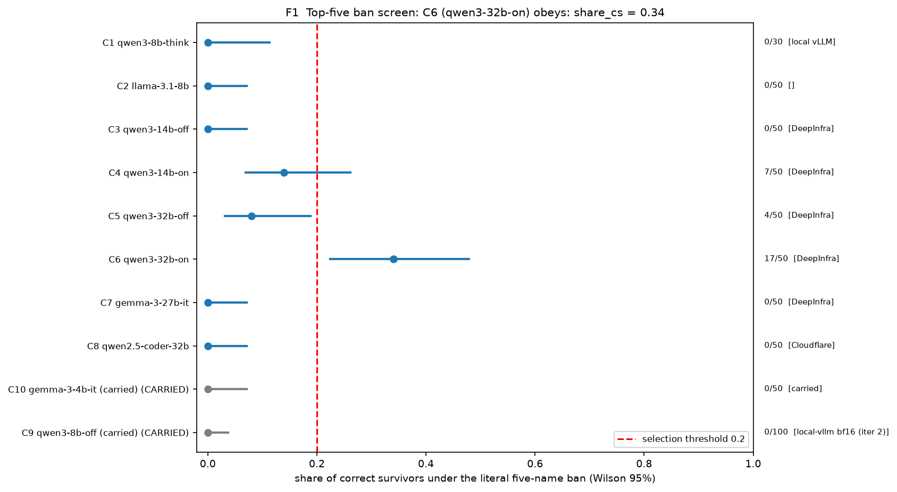

*Run figure. Only one row clears the red line.*

- So yes, but thinking is the switch, and even then it "obeys" in about a third of samples.
- **The parenthetical doesn't hold up.** Unit-weight Dijkstra is only 6 of the 17 survivors; 7 are Bellman-Ford/SPFA, plus random-priority frontiers and others.
- And unit-weight Dijkstra on a unit grid *is* BFS order. It's far from the banned five on maps built from algorithm names, but sits at their edge on the map built from name-scrubbed programs. Far in name, nearest cousin in behaviour.
- The genuinely different survivors are the Bellman-Ford ones.
- Evidence: `round-8/experiment-44/src/results/screen.json`, `landing.json`; `round-9/experiment-46/src/results/n4_verdict.json`.

### 11. Under a five-name ban most models rename, they don't obey

> original note: *in multi-ban model just renames the algorithm* [round-9/experiment-45] — *"under the five-name ban are lexically clean but mechanistically banned"*

- Over 10 model configs (546 programs): programs avoid the banned *names* far more often than the banned *mechanisms*. The gap is **0.70** by one instrument and **0.61** by the other, positive in 10 of 10 configs.
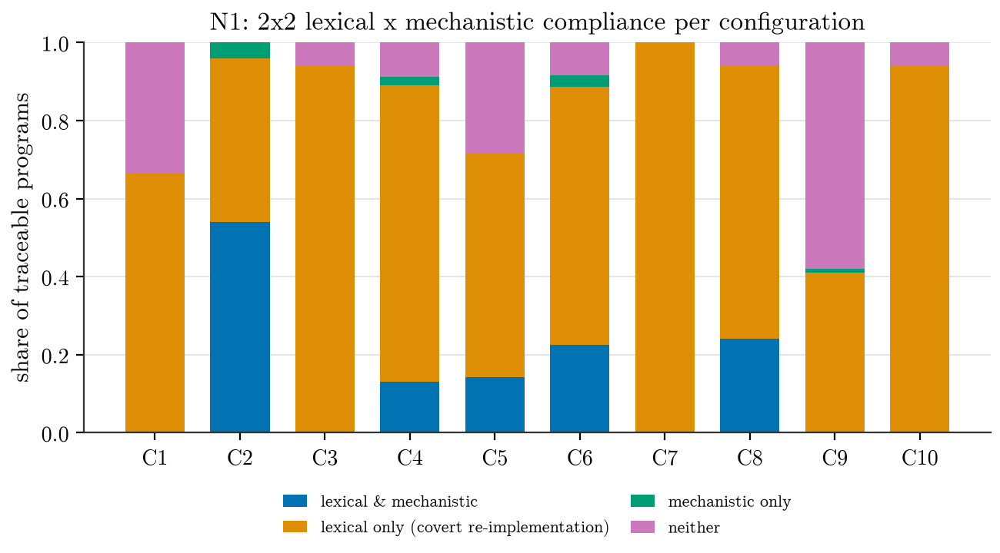

*Run figure. Orange = avoids the banned names but runs a banned mechanism (a rename). Blue = actually complies. C6 is Qwen3-32B with thinking.*

- 294 of 371 covert programs are plain BFS or DFS under another name.
- The quote is from the demo notebook and starts with "most programs…".
- **Exception, the model from finding 10:** of 76 hand-read survivors (Qwen3-32B and 14B), only 30% are renamed BFS (unit-weight Dijkstra). The rest are other known algorithms: coordinate-key heaps 18, grid Bellman-Ford 17, random-priority frontiers 8, a few others. Its gap is 0.63 or 0.31 depending on the instrument.
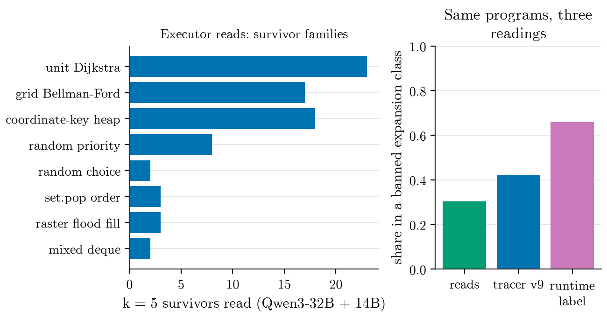

*Run figure. Left: hand reads of the 76 survivors. Right: the share counted as "still banned" depends heavily on which instrument reads them.*

- Descriptive only: the execution tracer failed its accuracy gate (182/260 = 0.70 vs 0.90 required).
- Not a fixed trait: on bin packing the bigger thinking models genuinely comply. A single ban is never renamed.
- Round 10 rewrote the conclusion from "banning the repertoire moves compliance to the names" to "renaming in Qwen3-14B, while Qwen3-32B moves mostly to other known disciplines".
- Evidence: `round-9/experiment-45/src/results/n1.json`, `n1_tracer.json`, `manual_reads_summary.json`; `round-10/evaluation-9/src/corrections.json`.

## Things I'd missed

Found by going through the other 45 experiments. Headline numbers checked in the result files, same as above.

### M1. The paper's actual headline: the fork on tasks where the model is undecided ([R7E35](round-7/experiment-35))

On the three tasks where Qwen3-8B already writes two algorithms, one generated token settles which one. Uncertainty about the algorithm once you know that token:

| Task | Before the token | After the token |
|---|---|---|
| MST weight (Kruskal vs Prim) | 0.82–1.02 bits (paper's range for the three) | **0.05 bits** |
| Trapped rain water | | **0.15 bits** |
| Valid anagram | | **0.19 bits** |

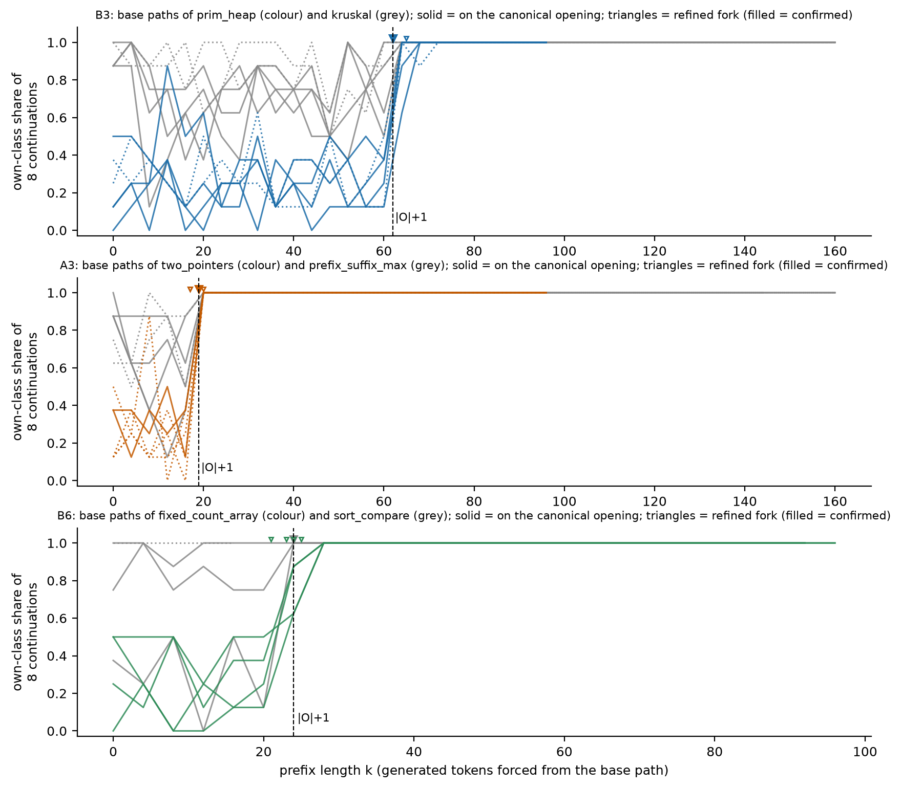

*Run figure. Each line is one program: keep its first k tokens, resample the rest, and see how often you get the same algorithm back. Noise, then a snap to 100% at the dashed line.*

- This generalises my finding 7 from one Gemma task to three Qwen tasks. All three pass the pre-registered bar of 0.3 bits.
- Not universal: weighted shortest path has no early fork, k-th smallest is decided before the first token, and Llama's grid task has no clean one (0.63 bits left).
- Evidence: `round-7/experiment-35/src/results/test1.json`.

### M2. Force the default's first body token and a ban evaporates ([R3E16](round-3/experiment-16))

Under a single-algorithm ban that normally works, prefill the answer with the opening of the default program and let the model continue.

| Prefilled | Share writing the banned default anyway |
|---|---|
| neutral `def solve(...):` line | 0.00 – 0.34 (ban holds) |
| the default's own opening | **0.98 – 1.00** (ban gone) |

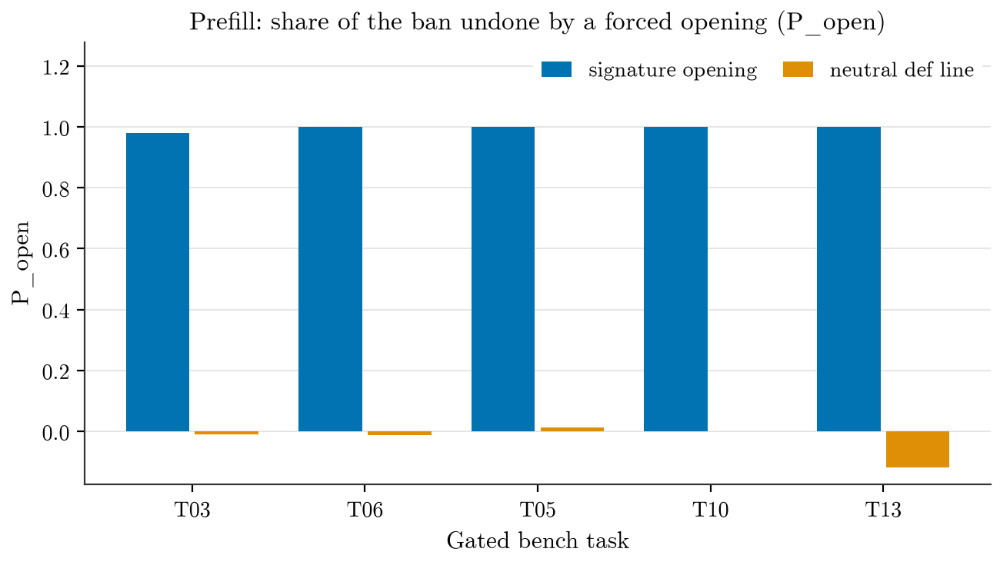

*Run figure. Blue = default's opening forced, orange = neutral def line. Five tasks.*

- On k-th smallest the difference is a single token: def line plus indentation gives 0.00, one more token (` nums`) gives 0.98.
- So the ban instruction loses to one token of the model's own code.
- Evidence: `round-3/experiment-16/src/results/prefill.json`, `replication.json`.

### M3. With an evaluator the 8B model does beat the textbook rule; aiming at the deciding token adds nothing ([R10E51](round-10/experiment-51), [R10E52](round-10/experiment-52), [R10E53](round-10/experiment-53))

Round 10 finally ran a FunSearch-style loop: generate bin-packing heuristics, keep the ones that score well, mutate.

| | Excess bins on held-out Weibull instances |
|---|---|
| best fit (textbook) | 3.98% |
| best evolved programs, run 1 | 1.40 – 2.43% |
| FunSearch's published heuristic | 0.68% |

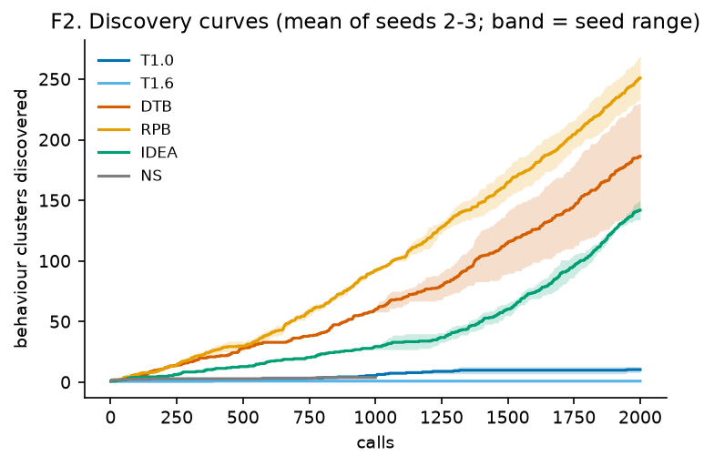

*Run figure, replication run. Distinct behaviours found vs calls. RPB = force a non-top token at a random position, DTB = force it at the highest-entropy ("deciding") position, IDEA = ask for a different idea, T1.0 / T1.6 = plain temperature.*

- Selection is what helps. Without it the model returns best fit.
- The run's own pet idea, "spend the randomness at the deciding token", failed its test: forcing at the deciding position vs a random position is 1.08x over four seeds. On TSP plain temperature 1.0 was just as diverse.
- **The one "novel" claim:** run 1 logged 8 programs as novel. All are one idea (prefer a leftover that is a whole multiple of the item size). One reader's call, and the replication found 0 of 40. The paper says "no confirmed new algorithm".
- The two runs disagree wildly on the temperature arms (373 clusters vs 1), unexplained. TSP stopped early (1,056 of 2,000 calls).
- Evidence: `round-10/experiment-51/src/results/v1.json`, `v3_final.json`; `round-10/experiment-52/src/results/verdicts.json`, `extension_ext45.json`.

### M4. Renaming is not a fixed habit: on bin packing the thinking models obey ([R10E54](round-10/experiment-54))

Same ban idea as findings 10 and 11, but scored by exact behaviour (which bin the rule picks on 2,000 states).

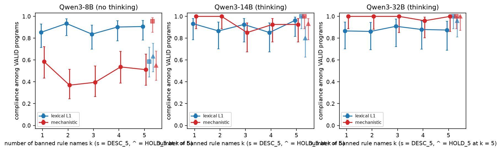

*Run figure. Blue = avoids the banned names, red = avoids the banned behaviour. Only the small non-thinking model has a gap.*

- Qwen3-8B, no thinking: avoids the names in 91%, the behaviour in 51%.
- Qwen3-14B and 32B with thinking: comply in behaviour 93–100%.
- But ask those two to "make a new algorithm" and they hand back best fit: 28/29 and 28/28.
- 0 of 1,143 one-shot programs beat best fit.
- Evidence: `round-10/experiment-54/src/results/rename_table.json`.

### M5. Bans are much flakier than finding 5 suggests ([R1E2](round-1/experiment-2), [R3E13](round-3/experiment-13), [R3E18](round-3/experiment-18), [R3E14](round-3/experiment-14))

- **Wording:** with 10 paraphrases of the ban, banning BFS leaves 62/100 BFS and banning Dijkstra leaves 72/100 Dijkstra. Four paraphrases give 10/10 BFS.
- **Task:** only 5 of 12 bench tasks obey a single ban at all.
- **Listing alternatives backfires:** on k-th smallest, a prompt banning five named algorithms (and leaving only the default allowed) gives **50/50 quickselect**, one of the banned ones. The list works as an advert.
- **Show and ban:** show a solution in context and the model copies it (0.93); ban it and the model goes back to its own default (24 of 31 cases), not to something new.
- **"Be novel" at length:** 485 of 575 answers to a long "invent a novel algorithm" prompt claim novelty. Zero are novel.

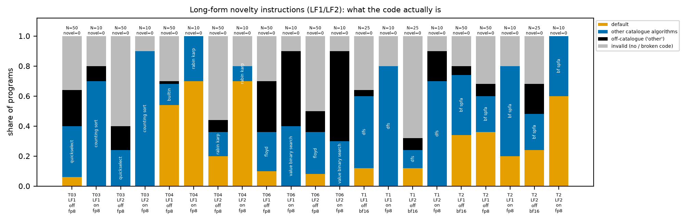

*Run figure. Every bar is annotated "novel=0". Yellow = the default anyway, blue = another textbook algorithm, grey = no working code.*

- Evidence: `round-1/experiment-2/src/results/phaseC_events.json`, `round-3/experiment-18/src/results/verify_headlines.json`.

### M6. Where noise works, and where a push lands ([R4E20](round-4/experiment-20), [R4E21](round-4/experiment-21), [R5E25](round-5/experiment-25)–[28](round-5/experiment-28))

- **Same seed, temperature vs noise:** temperature changes the algorithm in 0 of 20 seeds; plan noise in 17.25 of 20 on weighted shortest path (4.55 of 20 on k-th smallest). This is the paper's "55% vs 0%".
- **Only the task description is sensitive:** the same noise at the final prompt position gives 0 of 526 correct off-default programs, on the ban sentence 0 of 527.
- **Where it lands is predictable:** the model moves to the *base* model's second-favourite algorithm (3/3, 3/4 and 5/7 forecasts hit). Whether a task moves at all is not predictable.
- **Does not survive thinking:** with thinking on, noise moved the first-named approach in 1/10, 0/10, 0/10 seeds (README only).
- **Loses to text:** plan noise matches the best text-level plan sampler on only 1 of 5 tasks; a one-line intent sentence written by the base model scores 2.53 vs 1.09 on connected components (R5E27).
- Evidence: `round-4/experiment-20/src/results/rederive_headlines.json`, `round-5/experiment-25/src/results/a2.json`.

### M7. Tuning can flip the preference, not just sharpen it ([R8E43](round-8/experiment-43), [R9E50](round-9/experiment-50))

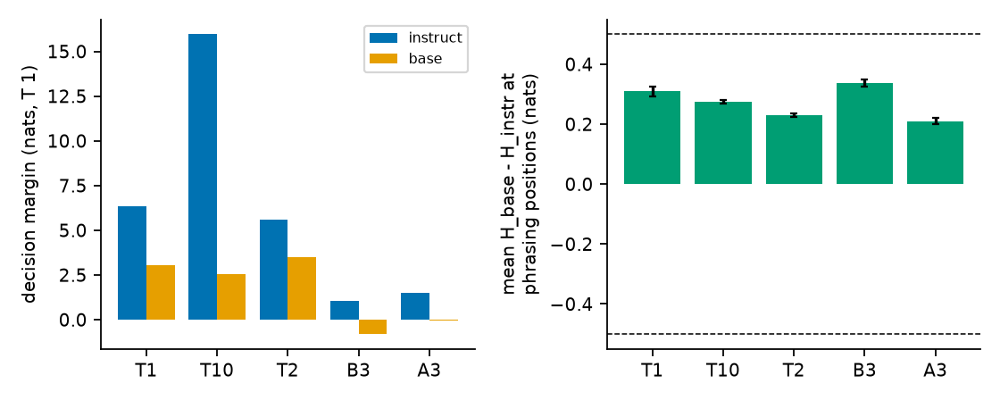

*Run figure, left panel. How strongly each model prefers the default at the deciding token. Blue = instruct, yellow = base.*

- On three collapsed tasks the instruct model's lead is 2 to 13 nats bigger than the base model's.
- On MST the base bar is negative: base leans Prim, instruct writes Kruskal. Same on Gemma's grid task.
- Caveat from the run itself: the fork is barely more affected than other uncertain positions (0.75–1.9x), so "tuning targets the fork" is not established.
- Evidence: `round-8/experiment-43/src/results/base_subarm.json`.

### Smaller things

- **Two exceptions to "random does as much":** on connected components a push aimed at the runner-up gives 24/50 DFS vs 0/50 for a matched random one (R4E22); transplanting base-model states gives 21/49 heap on top-k frequent vs 0/39 untouched, 44:0 against random (R5E24).
- **No low-rank "algorithm switch":** fitted subspaces write DFS 29/30, but controls with shuffled labels keep 63–87% of the effect (R7E33, R8E40).
- **Reading plans out as text fails:** an activation-to-text tool never names the planned algorithm before the code (0/112, 0/96; R6E32).
- **Search on textbook tasks:** evolutionary search found off-catalogue programs only on k-th smallest (78 of 2,500 vs 0 for prompts), all known techniques (R7E37).
- **A labeller bug to keep in mind:** on Gemma, the T2 labeller read array-based Dijkstra as Bellman-Ford; relabelled, ban avoidance drops from 0.96 to 0.11 (R4E23).

## Tasks the AI scientist used

Defaults are for Qwen3-8B, thinking off. It is collapsed (one algorithm in ~100% of samples) on T1, T2 and all 13 bench tasks.

**Movable** (random activation noise at the task description can shift the algorithm):

| Id | Task | Default |
|---|---|---|
| T1 | path on a grid (any valid path, not necessarily shortest) | BFS |
| T2 | weighted shortest path | Dijkstra |
| T03 | k-th smallest number | full sort |
| T05 | two sum | hash map |
| T06 | find duplicate | hash set |
| T10 | connected components | union-find |

T06 lost its movable status on fresh draws; a stricter re-test kept only T03 and T10.

**Non-movable bench tasks** (noise moves almost nothing; prompts sometimes still do, e.g. the novelty instruction on T04):

| Id | Task | Default |
|---|---|---|
| T04 | substring search | naive scan |
| T08 | Fibonacci | iteration |
| T11 | longest increasing subsequence | quadratic DP |
| T13 | merge intervals | sort and sweep |
| T14 | top-k frequent | sort by count |
| R1 | non-overlapping intervals | greedy by end |
| R3 | topological order | Kahn |
| R6 | first and last position in a sorted array | binary search |

**Held out:** R2, cycle detection in an undirected graph, default DFS with parent.

**Mixed tasks** (a different axis: the model already writes two algorithms; this is where the forking-token work happens):

| Id | Task | Split |
|---|---|---|
| B3 | minimum spanning tree weight | Kruskal 80 / Prim 19 |
| A3 | trapped rain water | prefix-suffix maxima 68 / two pointers 31 |
| B6 | valid anagram | sort-compare 77 / count array 13 / hash count 10 |

A and B are two later panels of 9 and 7 extra tasks (round 5). Round 10 adds online bin packing and TSP heuristics. Task definitions: `round-2/experiment-11/src/bench/`, `round-5/experiment-25/src/newbench/`, `round-5/experiment-26/src/src/units_spec.py`.

## How this was checked

- Each note → its experiment's `src/README.md` → headline numbers confirmed in a stored result JSON/CSV → later rounds searched for corrections (`round-*/evaluation-*`, `report_latex/`, `paper_latex/`).
- Nothing was re-run and no raw generations were re-labelled.
- Numbers quoted from *later* rounds (the paper's reframings in findings 2, 3, 4, 6) were read in prose only.
